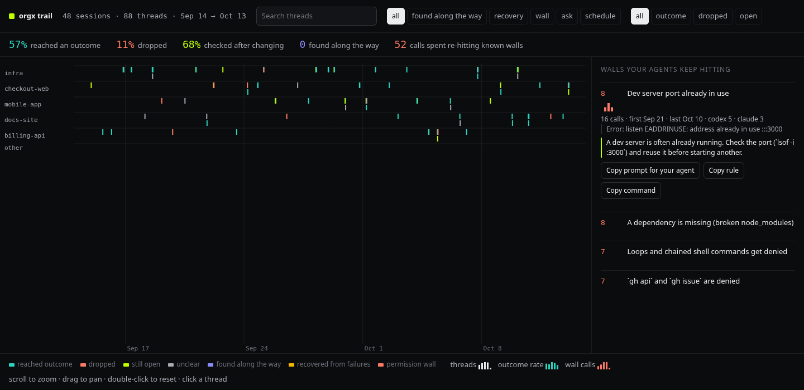

# orgx trail

See what your coding agents actually did, stop them repeating the same failures, and prove the fix worked.

For developers and teams using coding agents, Trail turns local session history into threads of work, repeated failures ("walls"), and reviewable fixes. It reads Claude Code, Codex, Cursor, GitHub Copilot, Gemini CLI, OpenCode and Factory Droid history. You choose which fixes to write into agent instructions.

## UI preview



Captured from the current browser ledger with the shipped demo's 48 made-up sessions; these are example results ([capture details](docs/images/preview-provenance.md)). [Try the live terminal demo](#quickstart), or [open the local browser UI](#example-find-a-repeated-failure). Trail serves the browser UI on your machine; there is no hosted Trail explorer. GitHub displays this screenshot, not a running app.

## Quickstart

Requires **Node.js 20+**. Try it without an account, API key, or existing session history:

```bash
npx -y @useorgx/trail --demo
```

Use `1`–`5` to switch views and `q` to exit. The demo reads no local session history and removes its temporary data when you exit.

To analyze your own history, run `npx -y @useorgx/trail`. It reads the supported clients' local history and opens the terminal explorer; no model is needed. Uploads and paid analysis are separate, explicit actions.

## Example: find a repeated failure

In a repository with local coding-agent history:

```bash
npx -y @useorgx/trail scan
npx -y @useorgx/trail walls --json
npx -y @useorgx/trail open
```

Open the tokenized localhost URL printed by `open`. Expand a wall to inspect its sample and suggested fix; search by project name to narrow the timeline. **Success:** a wall identifies the failure, how many separate sessions hit it, and a rule you can review before adopting. If there are no walls, that is a valid result; try `--demo` to explore a populated example. Press Ctrl-C to stop the browser server.

## Docs and troubleshooting

- `npx -y @useorgx/trail --help` lists commands and flags; the [command table](#what-you-can-do) explains the workflows.
- Empty view: run `scan` first and check that a supported client's local history exists. The demo works on a clean machine; Windsurf history is encrypted and is not read.
- Browser access: use the full URL printed by `open`, including its per-launch token. A bare localhost URL is rejected. Use `open --port 4748` if the default port is occupied.
- Data location and upload boundaries: see [Privacy](#privacy), [Data](#data), and `trail privacy`. `TRAIL_HOME` selects a separate local store; it does not change where client histories are discovered during a scan.
- Package verification and attribution: [Verify this package](#verify-this-package), [LICENSE](LICENSE), and [THIRD_PARTY_NOTICES.md](THIRD_PARTY_NOTICES.md).

## For agents

Connect the shipped **read-only stdio MCP server** after the person has scanned the history they want you to use. For Claude Code:

```bash
claude mcp add trail -- npx -y @useorgx/trail mcp
```

Other MCP clients can use this command configuration:

```json
{
  "mcpServers": {
    "trail": {
      "command": "npx",
      "args": ["-y", "@useorgx/trail", "mcp"]
    }
  }
}
```

Local MCP needs no OrgX auth or model key. It reads the local Trail store under the process user's permissions; it does not scan client histories for you. Set `TRAIL_HOME` in your client's server environment if the person chose a separate store. Connecting an agent makes that store's results available to the agent and its model provider.

Discover the available schemas with `tools/list`; the shipped tools are `trail_summary`, `trail_walls`, `trail_check`, `trail_threads`, `trail_search`, `trail_receipt`, `trail_workstream`, and `trail_review`. Scope queries to a project and return the evidence behind a result:

```text
Before changing checkout-web, use trail_walls with project="checkout-web".
Search past work with trail_search query="repo:checkout-web outcome:blocked".
Open a returned ID with trail_receipt and cite its checks and unmet criteria.
Before a shell call, use trail_check with the actual tool and command.
```

Verify connection with `trail_summary`, then inspect a returned receipt rather than treating an inferred outcome as proof. An empty summary usually means this store has not been scanned. MCP does not adopt fixes, upload history, buy credits, or approve paid analysis; those are separate person-controlled CLI flows. After new local data is added, reconnect MCP to refresh its cached summary and walls.

## Costs and payment

Local scanning, the demo, browser UI, and MCP require no account or paid model. The software is [Apache-2.0 licensed](LICENSE). Optional `trail deepen` shows a quote before confirmation: use OrgX credits after `trail connect`, or your own OpenRouter key (`--key-file`); model charges are separate. See [OrgX plans](https://useorgx.com/pricing) and [the shipped Jev model's pricing](https://openrouter.ai/typesafe/jev-1.13). Purchases happen through those services' billing flows, not Trail MCP.

## What you can do

| | |
| --- | --- |
| `trail` | read new work, then open the explorer |
| `trail goals` | see each piece of work, its detours, how it ended, and where the agent changed course (`--json`) |
| `trail receipts` | one [Agent Work Receipt](https://github.com/useorgx/agent-work-receipt) (v0.2) per piece of work: what was asked, whether each acceptance criterion was met and on what evidence, what was delivered, what checked it (`<id>`, `--json`, `--export file`). Each receipt also carries the review layer (`extensions['org.orgx.review/v1']`): every criterion quoted from the person's words with the message it came from, four kinds of proof per criterion (reviewed, tested, shown, seen live), the episodes of the work with stable ids tied to commits, and which layers of the record exist. OrgX renders it as the Work Receipt Review |
| `trail workstreams` | pieces of work joined across sessions by a shared PR, branch, rarely touched files, a pasted id, or an explicit continuation; words alone never join (`<id>`, `--all`) |
| `trail search <q>` | search your receipts: ranked text plus exact filters such as `outcome:blocked type:fix repo:app pr:12 conf:<0.6 unmet:tests` |
| `trail review` / `trail label` | the questions about your own work only you can settle (did it get done, was a criterion met); answers win over every guess |
| `trail deepen` | get more reliable outcomes. With your approval, Jev (TypeSafe's decision model) reads each step and piece of work. Trail marks an outcome corroborated when both reads agree at high confidence. The reads share Jev's step tags and are not independent; observed checks determine verification. Pay with OrgX credits after `trail connect`, or use your own OpenRouter key with `--key-file`. Trail shows a quote first and sends nothing until you confirm. |
| `trail walls` | find a wall: a failure your agents keep hitting in separate sessions. Each wall includes a fix (`--json` for agents). |
| `trail copy <id>` | copy a selected fix as a prompt, rule, or command |
| `trail adopt <id>` | write a selected fix into AGENTS.md / CLAUDE.md as a marked block (`trail unadopt <id>` removes it) |
| `trail methods` | list, publish or remove a current human-ratified OrgX method in a selected repository's AGENTS.md or CLAUDE.md; preview until `--yes` |
| `trail guard install` | stop known repeat failures before they happen in don't-ask runs |
| `trail card` | create a shareable summary image and post text |
| `trail share <id>` | a public page for a fix, measured across everyone who adopted it |
| `trail experiments` | did your AGENTS.md / CLAUDE.md edits change agent behavior? (95% intervals) |
| `trail bench` | test whether a model would repeat known failures, with and without your rules |
| `trail mcp` | give your agents tools for reading trail data: `claude mcp add trail -- npx -y @useorgx/trail mcp` |
| `trail open` · `trail watch` | open the browser view on localhost · follow the live session |
| `trail connect` | sign in to OrgX through [`@useorgx/wizard`](https://www.npmjs.com/package/@useorgx/wizard); trail never handles your password or key |
| `trail credits` | the people whose work trail is built on |
| `trail sync` | send session outlines, never transcripts, to OrgX; `--dry-run` shows exactly what would be sent |
| `trail sync --receipts` | send Agent Work Receipts to your OrgX workspace, where they join your team's work, map to your initiatives, and become searchable by agents; opt in, `--dry-run` first. Also sends the judgments you made along the way (corrections, rejected tool calls, denials, rules you stated) so OrgX can turn them into precedents; they are kept locally in `~/.orgx/trail/precedent-candidates.jsonl` until then |

### Deliver a ratified OrgX method

`trail methods list --workspace <workspace-id>` reads a current canonical method index using the OrgX sign-in from `trail connect` or `ORGX_API_KEY`. This command does not read session history. Copy the selected method's ID, version and digest into a preview, which fetches its full operational instructions and provenance:

```bash
trail methods publish --workspace <workspace-id> --repo /path/to/repository \
  --method <canonical-method-id> --version <version> --digest sha256:<digest> \
  --to AGENTS.md
```

Add `--yes` to write after reviewing the method. Choose `--to CLAUDE.md` for that file instead. The target must be a regular file at the selected repository root; missing targets are created. The publisher keeps unrelated instructions, including their line endings, and owns only its marked method block. A human rewrite replaces that block under its new canonical version. A current revocation or `trail methods remove` with the same scope and tuple removes that block. Absence, stale authority, changed files, edited managed blocks, and version or digest conflicts refuse the write.

Each invocation checks live authority before writing. This is an explicit command, not a background revocation watcher. Files carry a reminder to recheck current authority before using a method. A local publisher lock and a final content check detect cooperating publishers and edits made before the final rename; they do not lock arbitrary editors or the server's authority transaction.

Successful publication reports `method.delivered` to OrgX as a producer report with assurance rung 0. A failed report is shown as `unrecorded`; repeating the same publication retries it without rewriting the file. Delivery does not claim `method.used`, `behavior.changed` or `outcome.improved`. Those stages still require their existing gate, action and measured outcome witnesses. No instructions, local repository path or session transcripts are uploaded in the delivery report.

`trail watch` now tails Claude Code and Codex JSONL by byte offset and builds local goal receipts as work changes. Add `--receipts` to stream provisional checkpoints to OrgX; a final receipt follows 30 minutes without material activity, after outstanding tool calls finish. Receipt hashes use the AWR RFC 8785 content hash and cover every field except integrity, including evidence excerpts. Other transcript formats use their existing snapshot readers.

After `trail connect`, `trail receipt-hook install` enables automatic Claude Code uploads through UserPromptSubmit, PostToolUse and Stop hooks. A private local worker retains the byte cursor and pending calls across hook invocations. `trail receipt-hook status` shows the integration, and `trail receipt-hook uninstall` removes it while retaining your other hooks and settings. Watch and hook uploads carry the same asks, summaries and excerpts as `trail sync --receipts`, with secret redaction and your configured personal-data masking.

In the explorer, on a wall: `c` copies a prompt for your agent, `r` the rule, `x` the command, `a` adopts it.

## How it works

1. Trail reads each session into requests, agent messages, and tool calls. Reasoning and full messages go to a separate local file (`~/.orgx/trail/language`).
2. Trail records what each tool call did and whether it passed, failed, or was refused. It labels each message or reasoning step as a plan, hypothesis, evidence, decision, change of course, verification, completion claim, handoff, or blocker. Rules do this by default; Jev does it when you run `trail deepen`.
3. Trail groups the moves into a thread: one sequence of agent work. The explorer and repeated-failure checks use these sequences.
4. `trail goals` joins each request to its detours. It reports how the piece of work ended and points to the step that proves the result.

Against Codex labels for 58 unseen work sequences, trail found the right piece-of-work boundary 89% of the time. The shorter sequences alone reached 38%. It found the right outcome 47% of the time, compared with 10% from the shorter sequences. These are model labels, not human labels; the lab (`lab/`) is where that gets fixed.

## Verify this package

After installing trail in a project, run `npm audit signatures` to verify registry signatures and provenance for installed packages. The [npm package page](https://www.npmjs.com/package/@useorgx/trail) also shows a provenance badge for releases with a verified attestation.

Each release is built from a tagged commit by [`.github/workflows/publish.yml`](.github/workflows/publish.yml). The workflow requires a `vX.Y.Z` tag that matches `package.json`, runs the tests, and publishes through npm trusted publishing.

## How far to trust it

- **Facts** — denials, failures and ships — are read straight from the transcript.
- **Judgments** — intent, discoveries, whether a thread was dropped — are inferred, and the Quality tab says how well.
  "Dropped" comes from a small tree model (`src/model/abandon.json`); your own labels are the real test.
- **Effects** are compared like with like: same repo, same client, same permission mode. When the permission mode
  changed around a fix, trail says "confounded" instead of claiming a win.
- `trail bench` measures a model's **planned** first calls, not executed runs, and says so.

## Built on

Trail is built on other people's ideas. None of them endorse it; this is what we took from each. `trail credits` shows the longer version.

| Work | What trail took from it |
| --- | --- |
| [Clio: privacy-preserving insights into real-world AI use](https://www.anthropic.com/research/clio) · Alex Tamkin and the Clio team at Anthropic, 2024 | A fix’s public numbers appear only once at least 5 separate people have adopted it. Default aggregate `trail sync` sends counts and move strings, with titles only through `--with-titles`. Receipt sync, receipt watch, and opt-in receipt hooks can send asks, summaries, and evidence excerpts; see [Privacy](#privacy). |
| [Error analysis for AI systems (open coding → axial coding → count → judge)](https://hamel.dev/blog/posts/evals-faq/why-is-error-analysis-so-important-in-llm-evals-and-how-is-it-performed.html) · Hamel Husain and Shreya Shankar, 2025 | The walls are failure types counted across real sessions, and trail’s classifier is checked against human labels in a labeling lab. (We wrote our codebook before our notes, which they warn against; the next labeling pass starts from notes.) |
| [Sniffly: a dashboard over your local Claude Code logs](https://github.com/chiphuyen/sniffly) · Chip Huyen, 2025 | Lead with one surprising number about your own agents, found locally. |
| [Docent: searching agent transcripts against a rubric, with cited evidence](https://transluce.org/docent/blog/introducing-docent) · Transluce, 2025 | Every adopted fix is reported as a measured before and after, not a claim. |
| [Measuring AGENTS.md: what five runs show that one doesn’t (AAIF)](https://aaif.io/blog/measuring-agents-md-what-five-runs-show-that-one-doesn-t) · Andrea Griffiths, 2026 | trail experiments reports intervals and says “no detectable change” when the interval spans zero. We learned the same lesson the hard way: our first before/after was confounded by a permission-mode switch. |
| [Measuring the impact of early-2025 AI on experienced open-source developer productivity](https://metr.org/blog/2025-07-10-early-2025-ai-experienced-os-dev-study/) · Joel Becker, Nate Rush, Beth Barnes and David Rein (METR), 2025 | trail compares like with like (same client, same permission mode) and marks a result confounded instead of reporting it. |
| [AGENTS.md: a simple, open format for guiding coding agents](https://agents.md/) · The AGENTS.md contributors (now stewarded by the Agentic AI Foundation), 2025 | Fixes are written where agents already look, as a removable block in AGENTS.md or CLAUDE.md. |
| [Entire: agent checkpoints stored in git, next to the code](https://entire.io/) · Thomas Dohmke and the Entire team, 2026 | Lessons live in the repo, in files a team reviews like any other change. |
| [Agent Trace: an open, vendor-neutral spec for AI code attribution](https://agent-trace.dev/) · Cursor, 2026 | trail’s upload format (orgx-trail-threads/v1) is a short, versioned contract you can inspect with --dry-run; publishing it as an open spec is next. |
| [ccusage: token and cost analysis from local agent logs](https://github.com/ccusage/ccusage) · ryoppippi and the ccusage contributors, 2025 | npx, no account, nothing uploaded, a first answer in about 40 seconds. |
| [Portable Game Notation (PGN)](https://en.wikipedia.org/wiki/Portable_Game_Notation) · Steven J. Edwards, 1993 | Each thread is a move string (probe, run, change, check, ship, failed, denied) you can read at a glance and compare. |
| [Stigmergy: coordination through traces left in the environment](https://pubmed.ncbi.nlm.nih.gov/10633572/) · Pierre-Paul Grassé, 1959 | A wall one session hit becomes a trace the next session reads before it starts, instead of every session starting from zero. |

## Privacy

`trail privacy` shows what trail keeps, where, who can read it, and what each command sends, counted from the files.
Secrets are removed before anything is stored or sent, using gitleaks' 221 provider rules (plus OrgX and OpenRouter keys);
trail's folder is readable by you only. Uploads are explicit: `trail sync` sends counts and move strings
(`--with-titles` adds titles); `sync --receipts`, `watch --receipts`, and opt-in receipt hooks can send asks, summaries,
and evidence excerpts. `trail deepen` sends analysis text after a quote you confirm. Review the command table before
enabling these flows. For names, emails, phones and addresses too,
`trail privacy --pii on` masks outgoing text locally with [OpenAI Privacy Filter](https://github.com/openai/privacy-filter).

Claude Code deletes transcripts older than 30 days by default (`cleanupPeriodDays`); trail keeps its own outlines after that.

## Data

Everything lives in `~/.orgx/trail` (override with `TRAIL_HOME`). Delete that folder to forget it all.

Built by [OrgX](https://useorgx.com).
